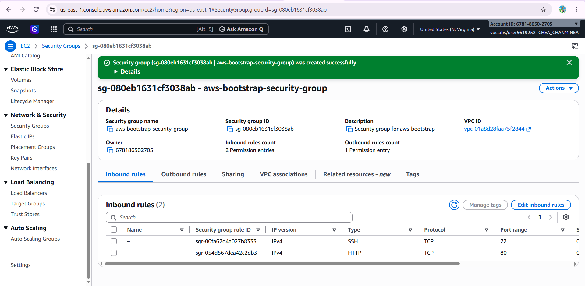
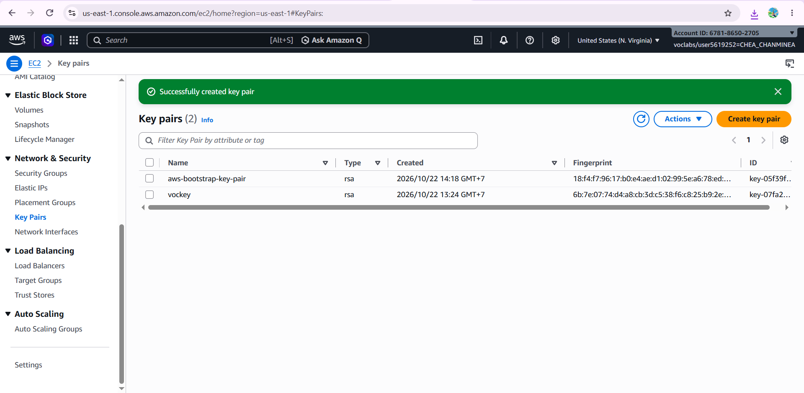
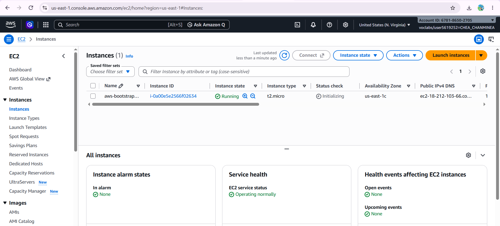
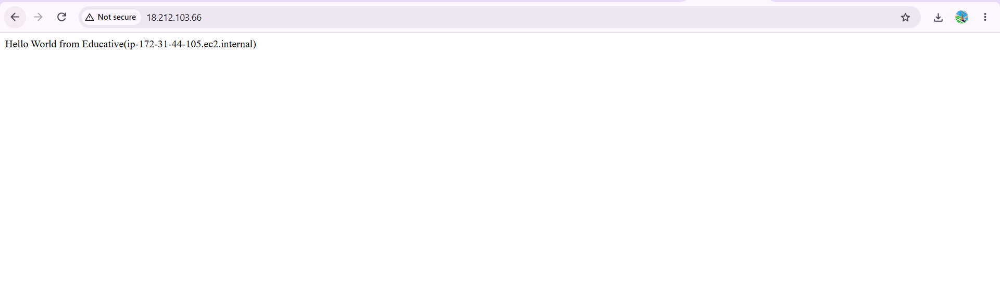
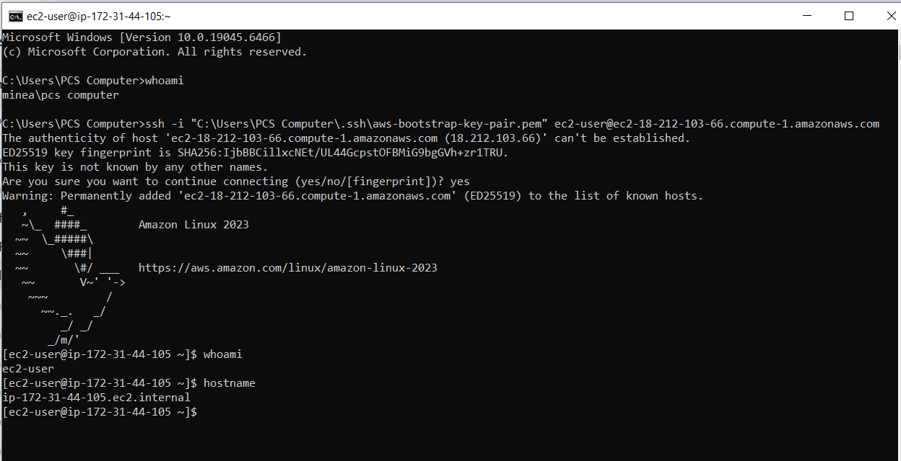
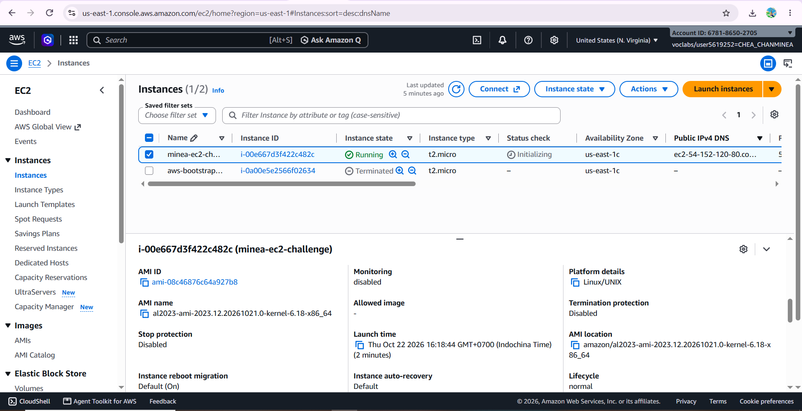
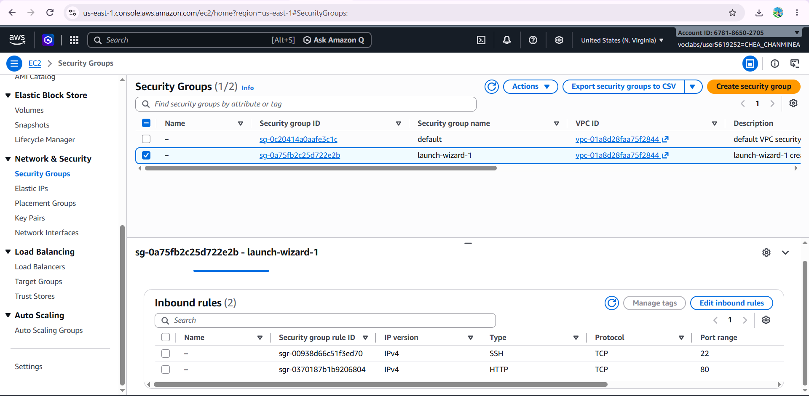
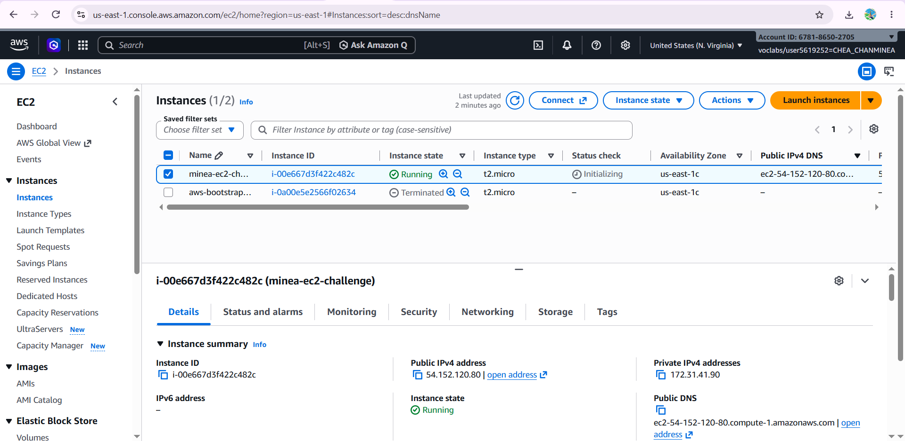
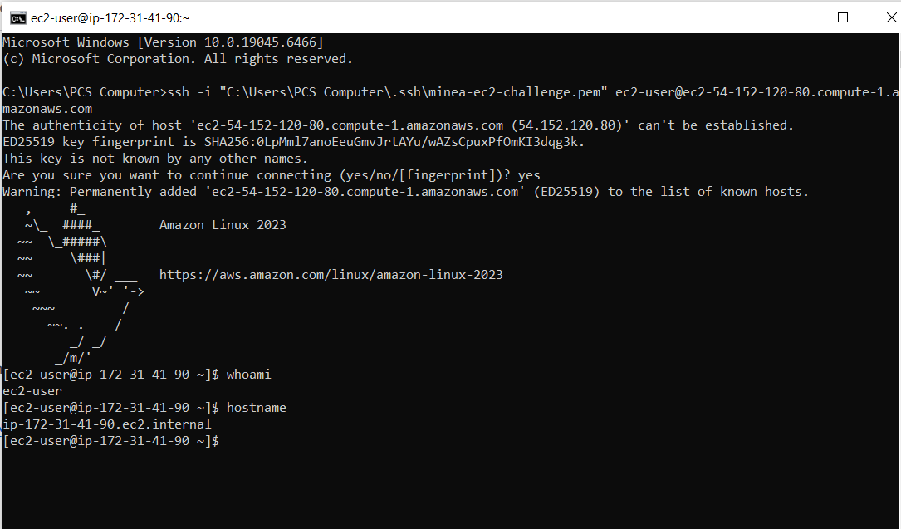
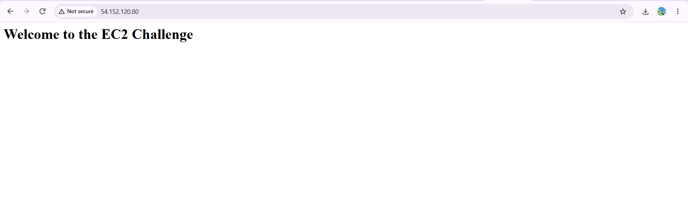

# Cloud Lab 1 Submission — Amazon EC2

- **Student name: Chea Chanminea** 
- **Student ID: e20220335**
- **Learner Lab user name: voclabs/user5619252=CHEA_CHANMINEA**
- **Date completed: 10/22/2026**

---

## Part 1.1 — An Amazon EC2 Walkthrough

### Security group



### Key pair



### Instance details



### Browser test



### SSH connection



I connect with my own SSH client.

---

## Part 1.2 — EC2 Web Solution (Challenge)

### Launch configuration



### Security group



### Running instance



### Commands on the instance



Paste the commands you ran to install the web server and create `index.html`:

```bash

#!/bin/bash
# Update the system package manager
yum update -y

# Install Apache (httpd)
yum install -y httpd

# Start Apache and enable it to run on boot
systemctl start httpd
systemctl enable httpd

# Create the index.html file with the required message
echo "<h1>Welcome to the EC2 Challenge</h1>" > /var/www/html/index.html

```

### Browser test



---

## Questions

1. My security group has an SSH rule and an HTTP rule.

   An SSH rule allows me(admin) to securely log into the instance’s command line from my computer to manage the server, run commands, or modify files, while an HTTP rule allows the general public (web browsers)access the website hosted on my instance over the standard, unencrypted web port (Port 80).
   
   If I delete the HTTP rule, my website will immediately stop loading for visitors. Browsers will time out trying to connect, even though the server itself is still running perfectly.
2. In Part 1.1, even though I never logged in to install the web server, the User Data  Script that I write into the optional advanced text box installed it automatically.
   And it run actually once, automatically, during the very first boot cycle of the EC2 instance right after AWS provisioned the virtual hardware.
3. The web page open with `http://` but not with `https://` because I have set only a rule allowing traffic on Port 80 (HTTP), and there is no rule for Port 443 (HTTPS). That is why there is no HTTPS traffic allowed. 
4. Part 1.2 asked for a 10 GiB root volume, I set it in the launch settings under the "Configure storage" section. 
  
   I changed the default 8 GiB to 10 GiB. To view it, I log into the instance via SSH and run the command df -h which shows disk space usage or lsblk which lists block storage devices. Then, look for the line representing the root partition with this sign / to see its total size.

## Problems and how I solved them (optional)

## AI note (optional)

One suggestion an AI tool gave you and how you checked it.

## Clean up

- [Completed] Part 1.1: instance terminated, key pair and security group deleted.
- [Completed] Part 1.2: instance terminated, security group (and key pair, if any) deleted.