# Cloud Lab 2 Submission — Load Balancer and Auto Scaling

- **Student name:** Chea Chanminea
- **Student ID:** e20220335
- **Learner Lab user name:** voclabs/user5619252=CHEA_CHANMINEA
- **Date completed:** 08/11/2026

---

## Security groups

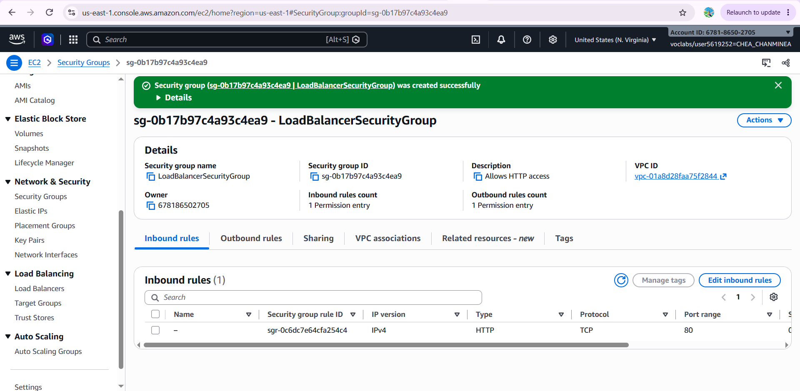

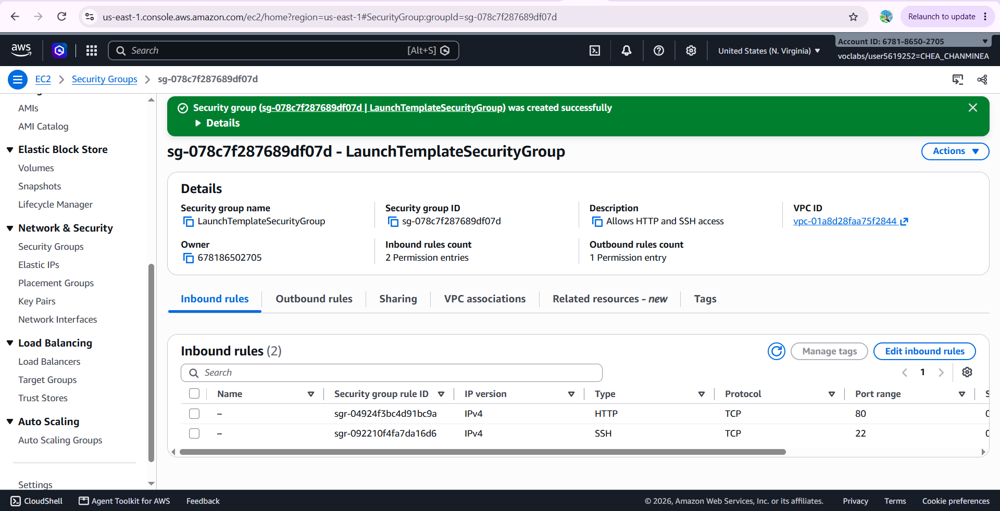

## Target group

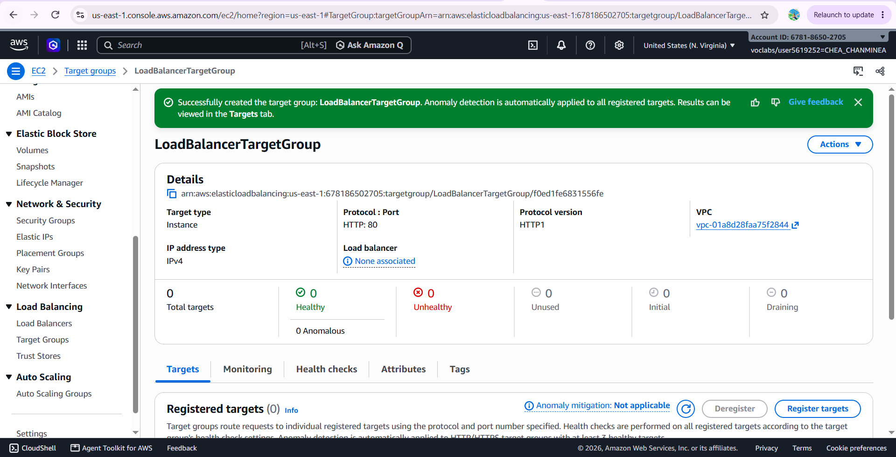

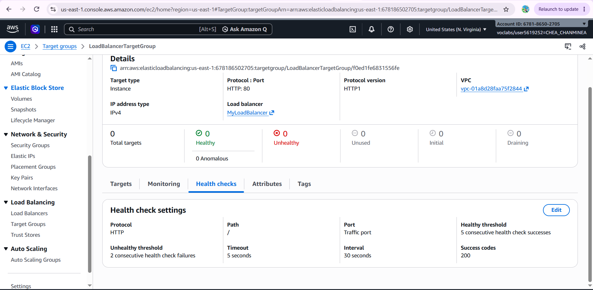

## Application Load Balancer

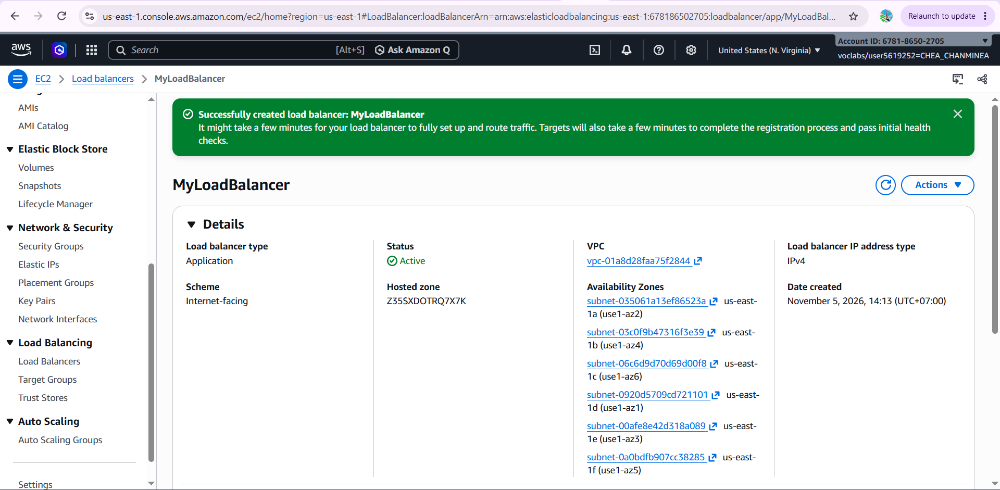

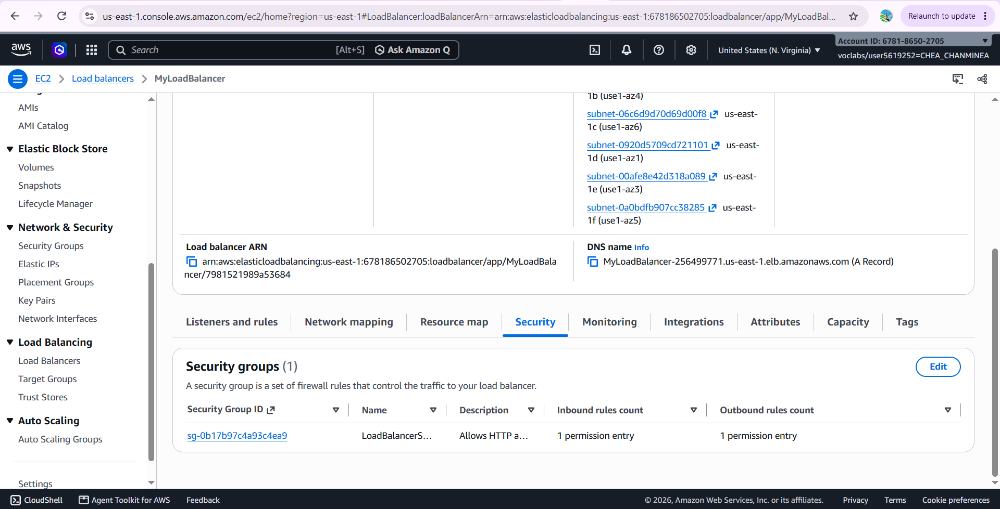

## Launch template

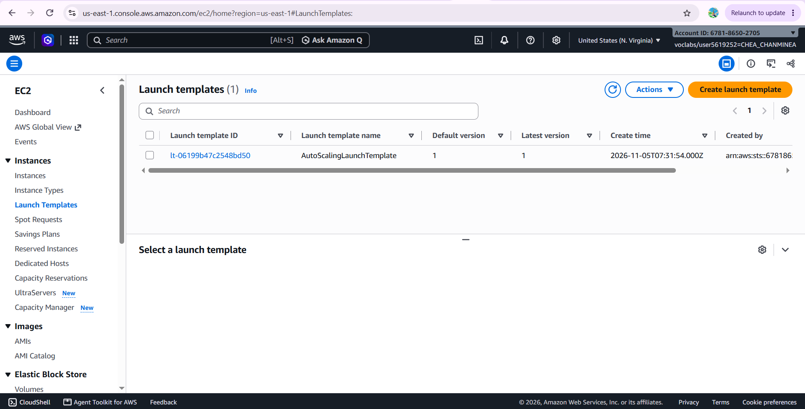

## Auto Scaling group

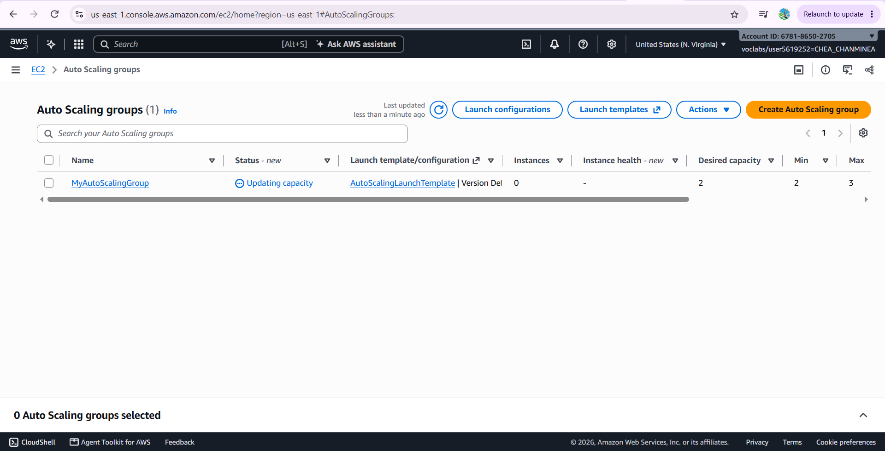

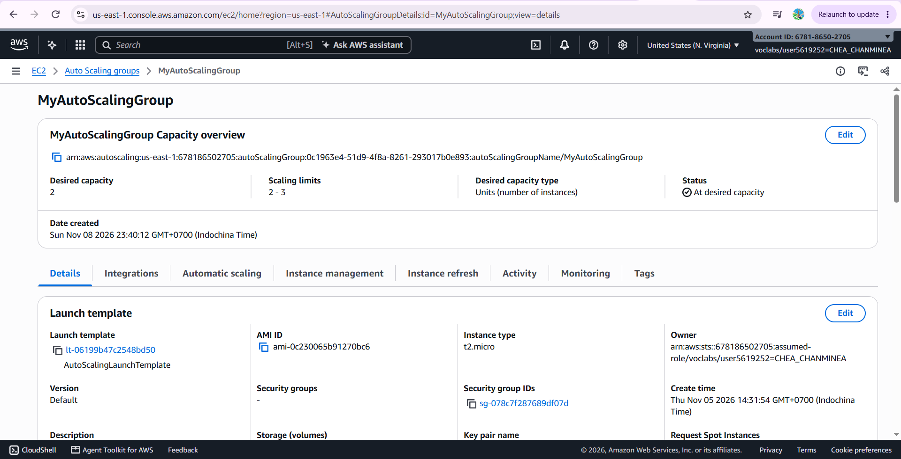

## Load balancing test

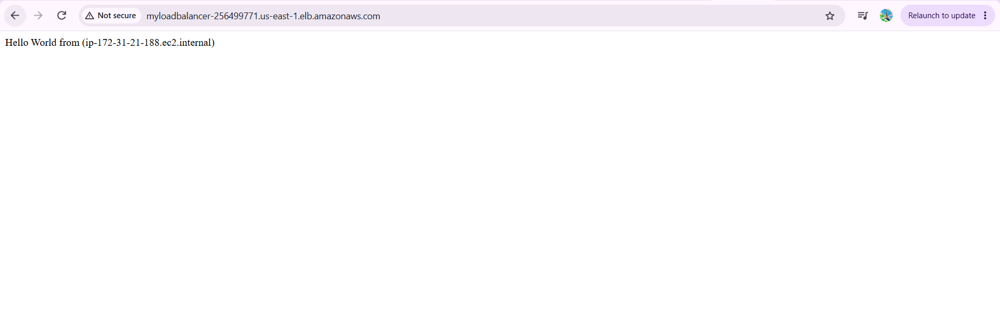

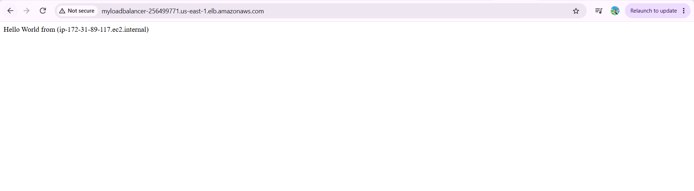

## Simulated application failure

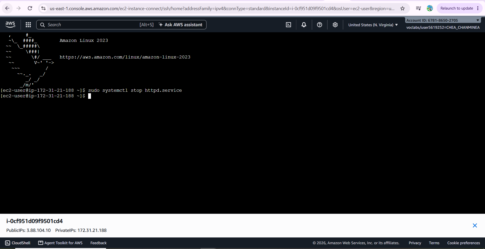

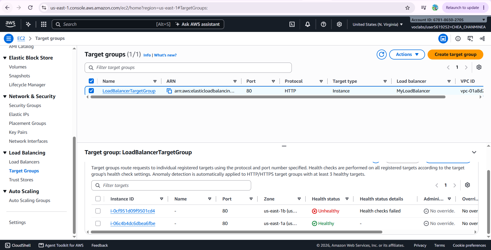

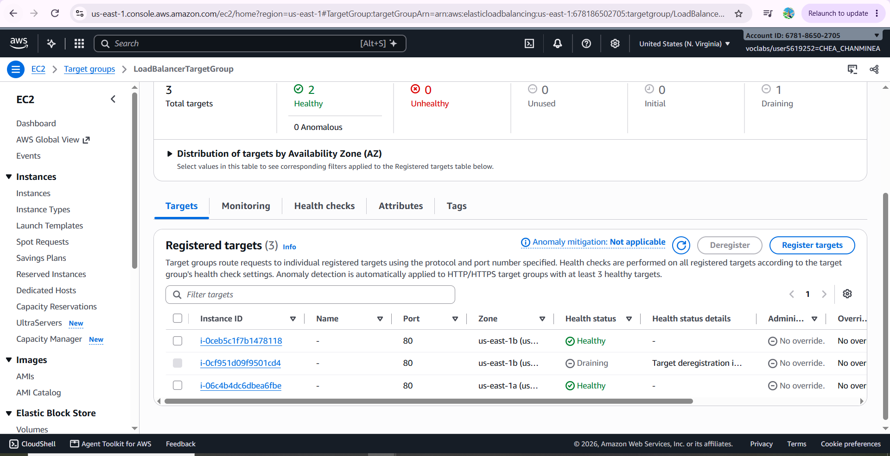

About how many minutes passed between stopping `httpd` and the new instance becoming healthy?

---

## Questions

1. Each instance serves the same page but shows its own host name. The load balancer picks which instance handles each request, so a different instance can answer each time.

2. There are two kinds of "Healthy":

    - EC2 status checks: Is the machine powered on and reachable? This still passed, which is why it showed running.

    - Target group health check: The load balancer sends an HTTP request to the instance (on a set port and path, like port 80 and /) and expects a success response (usually 200). 

    With httpd stopped, nothing was listening on port 80. The machine was alive, but the web server wasn’t answering. After a few failed checks in a row, the target was marked unhealthy.

3. It is Auto Scaling Group is the one who replaces the failed instance. For Load Balancer, it receives client traffic and spreads it across targets. It doesn’t create or delete servers.For Target Group, it holds the list of instances and runs the health checks. It tells the load balancer which targets to stop sending traffic to. For Auto Scaling Group, it keeps the right number of instances alive. It terminates unhealthy ones and launches new ones from the launch template.
4. With Disired 2, Minimum 2, & Maximum3
    - Normally: 2 instances, because desired capacity is the target the ASG maintains.

    - When there could be 3: The ASG may add an instance when a scaling policy triggers (for example, high CPU), or if someone manually raises desired capacity to 3. It will never go above the maximum of 3 or below the minimum of 2.
5. For me, I would edit the inbound HTTP rule (port 80) on the instances’ security group. Instead of allowing 0.0.0.0/0, I would set the source to the load balancer’s security group. This way the instances only accept web traffic that comes through the load balancer, and anyone trying to reach an instance directly is blocked.

## Problems and how I solved them (optional)

## AI note (optional)

One suggestion an AI tool gave you and how you checked it.

## Clean up

- [done] `MyAutoScalingGroup` deleted and its instances terminated.
- [done] `AutoScalingLaunchTemplate` deleted.
- [done] `MyLoadBalancer` and `LoadBalancerTargetGroup` deleted.
- [done] Both security groups deleted.