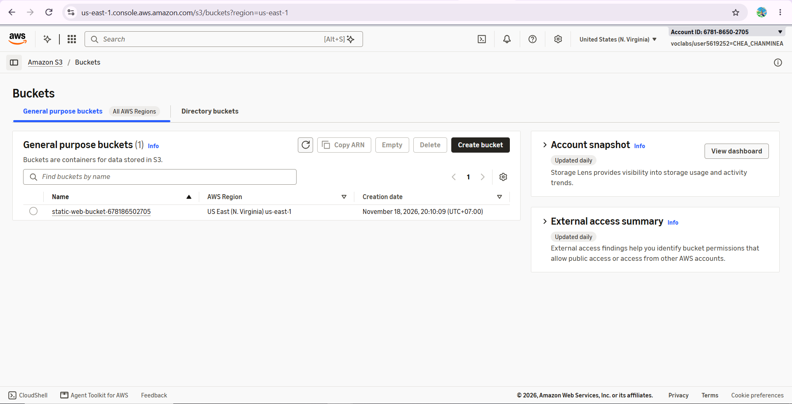
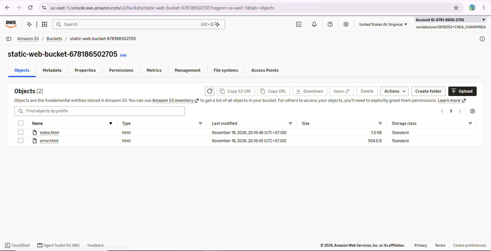
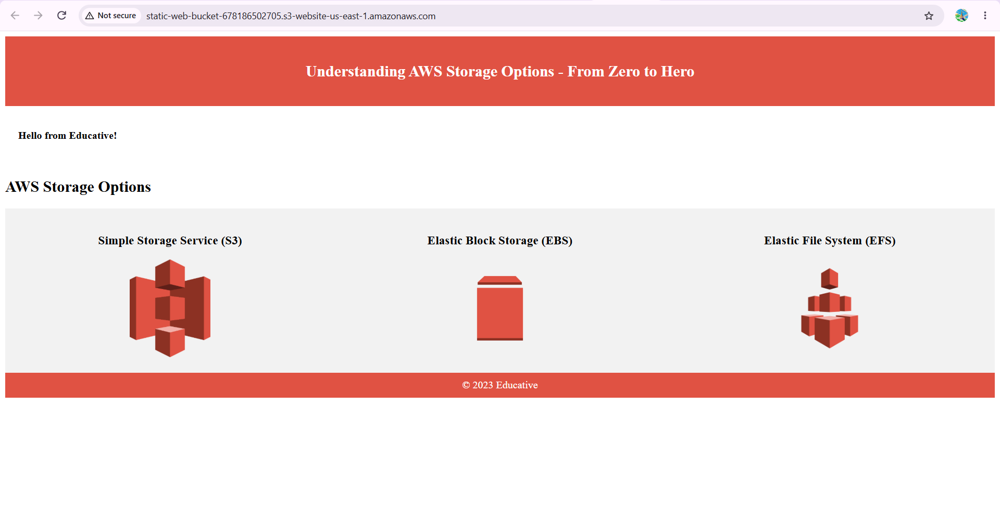
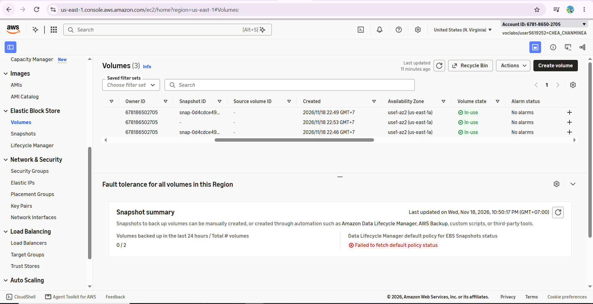
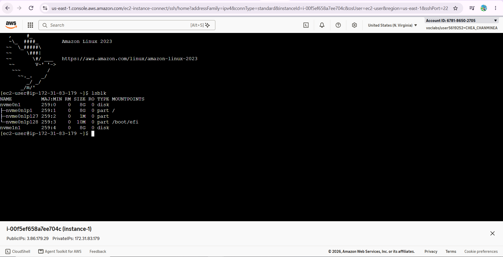
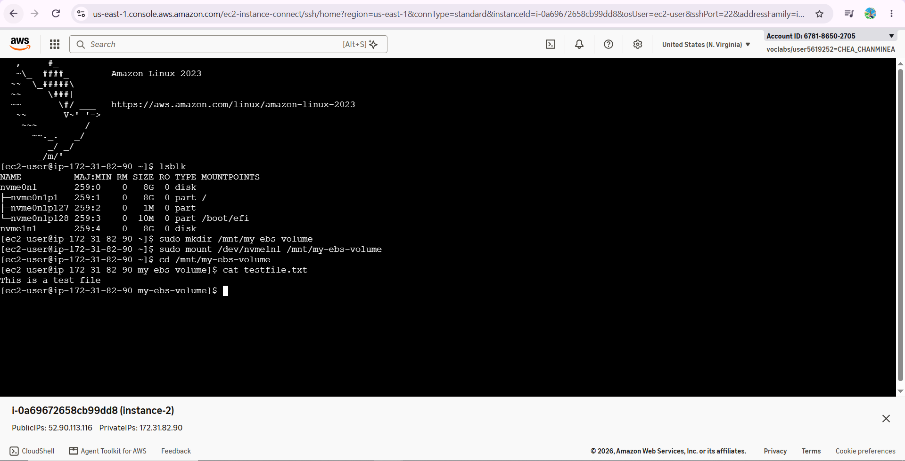
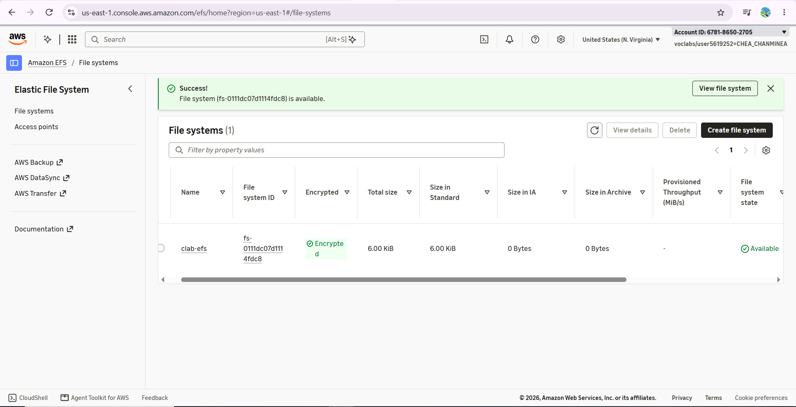
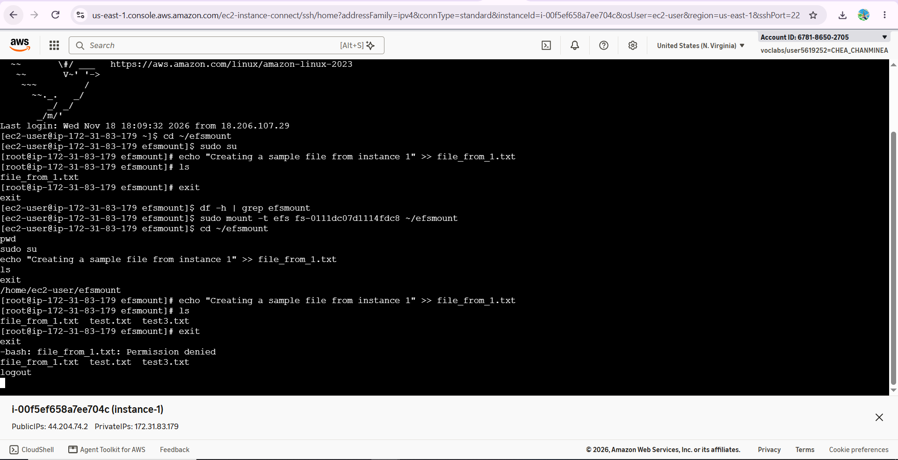
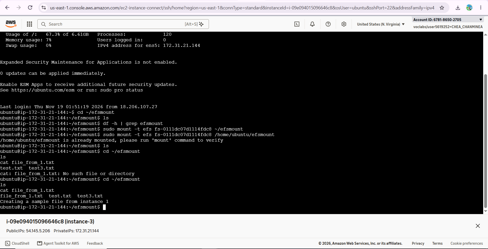

# Cloud Lab 3 Submission — AWS Storage Options

- **Student name:** Chea Chanminea
- **Student ID:** e20220335
- **Learner Lab user name:** voclabs/user5619252=CHEA_CHANMINEA
- **Date completed:** 19/11/2026

---

## Part 2.1 — Amazon S3

### Bucket list

### Uploaded files

### Static website

---

## Part 2.2 — Amazon EBS

### Volumes page

### Attached volume (`lsblk`)

Which device name did your volume get (`xvdf`, `nvme1n1`, ...)?

### File read on instance-2

---

## Part 2.3 — Amazon EFS

### File system and mount targets

### File created on instance-1

### File listed on instance-3

---

## Questions

1. A new S3 bucket is private by default, and turning on static website hosting only creates the endpoint; it does not make the files public. Block Public Access is also on by default. So anonymous visitors had no permission to read the objects, and S3 returned 403. After I turned off Block Public Access and added a bucket policy allowing everyone (Principal: "*") to perform s3:GetObject on the bucket’s objects, the browser could read the files and the endpoint returned the page.

2. testfile.txt survived because it was on the Backup Volume, a separate EBS volume that I detached and attached to instance-2, so the data stayed on the volume and not on the instance. A file saved on instance-1’s root volume would have been lost when I terminated instance-1, because the root volume has “Delete on termination” enabled by default and is deleted with the instance.

3. A new EBS volume is blank and has no file system, so the OS cannot store files on it. I ran mkfs on instance-1 to create the file system. On instance-2 the volume already had a file system, so I only needed to mount it. Running mkfs again would have formatted the volume and erased testfile.txt.

4. An EBS volume is block storage that behaves like a hard drive attached to one instance at a time (within one Availability Zone), so it had to be detached before another instance could use it. EFS is a network file system (NFS), so many instances connect to the same storage over the network and can read and write at the same time. The instances had to be in the mount targets’ subnets because an instance reaches EFS through a mount target, which is a network endpoint with an IP address in a subnet in each Availability Zone. An instance in an AZ with no mount target has no endpoint to connect to, so the mount fails. The mount target’s security group must also allow NFS (port 2049).

5. (a) A website’s images: S3. It is cheap, durable object storage that serves files over HTTP without needing a server.
(b) The disk of a database server: EBS. It gives fast, low-latency block storage that works like a real disk attached to one server.
(c) A folder shared by several web servers: EFS. It is a shared file system that multiple instances can mount at the same time.

## Problems and how I solved them (optional)

## AI note (optional)

One suggestion an AI tool gave you and how you checked it.

## Clean up

- [done] Instances `instance-1`, `instance-2`, `instance-3` terminated.
- [done] `clab-efs` and **Backup Volume** deleted.
- [done] Security groups `efs-sg` and `ec2instances-sg` deleted.
- [done] S3 bucket emptied and deleted.