# Cloud Lab 4 Submission — Amazon VPC

- **Student name:** Chea Chanminea
- **Student ID:** e20220335
- **Learner Lab user name:** voclabs/user5619252=CHEA_CHANMINEA
- **Date completed:** 12/11/2026

---

## VPC and internet gateway

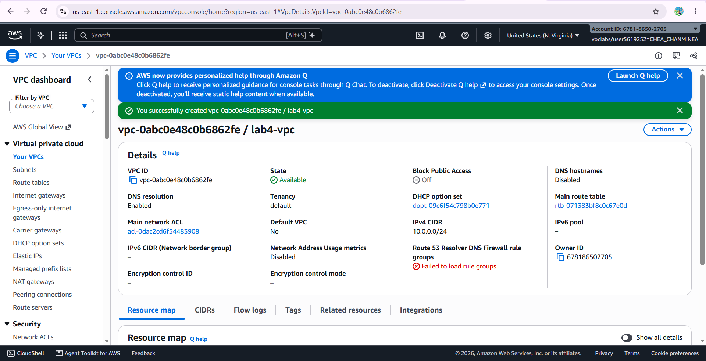

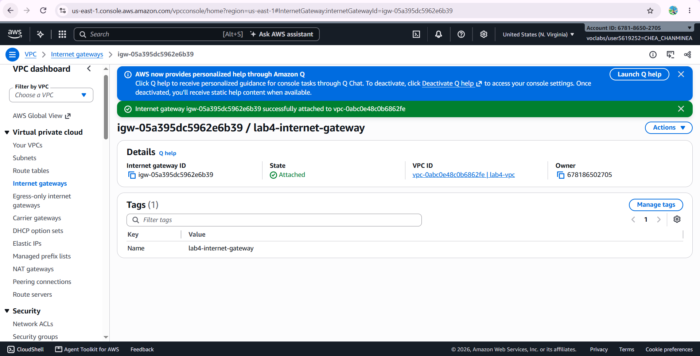

## Public subnet

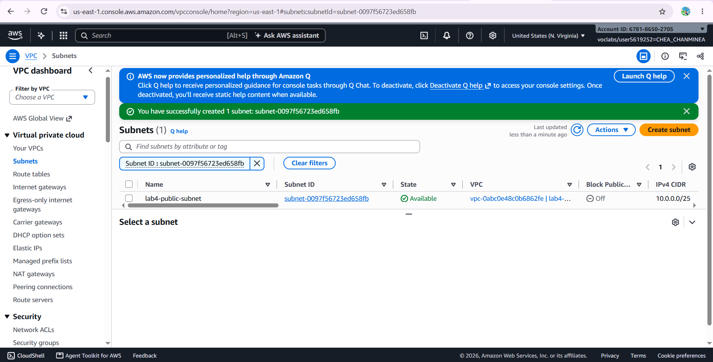

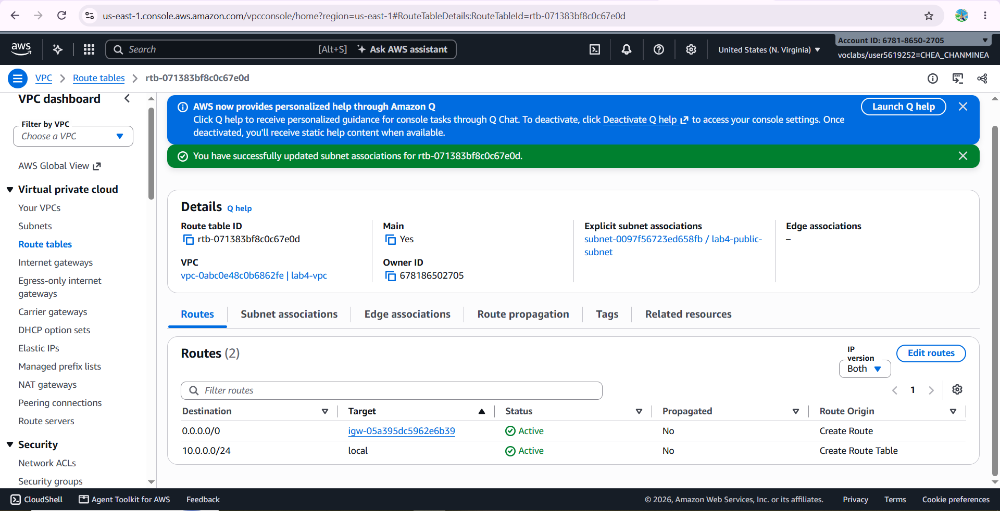

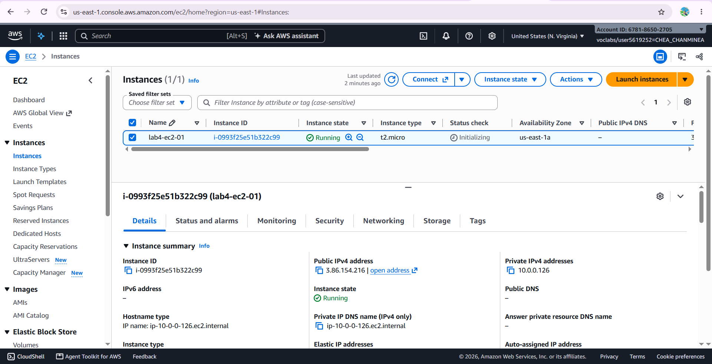

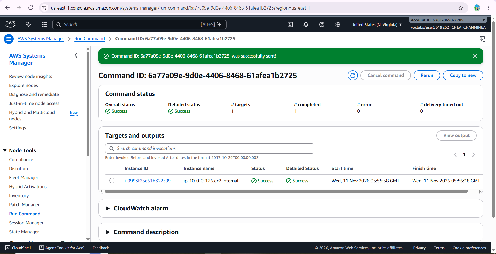

## Private subnet

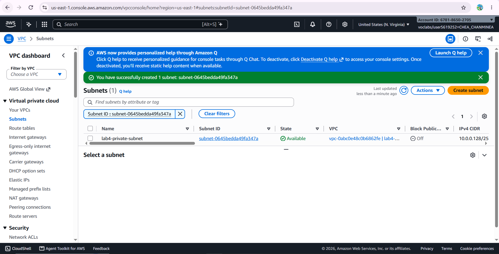

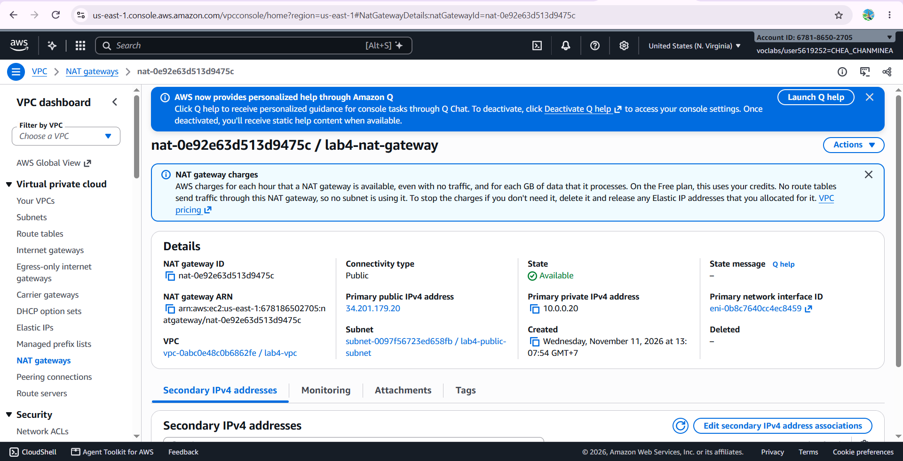

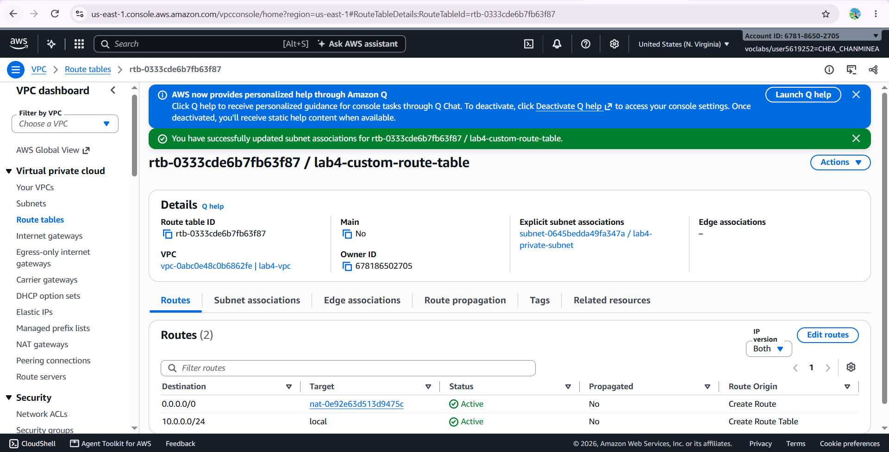

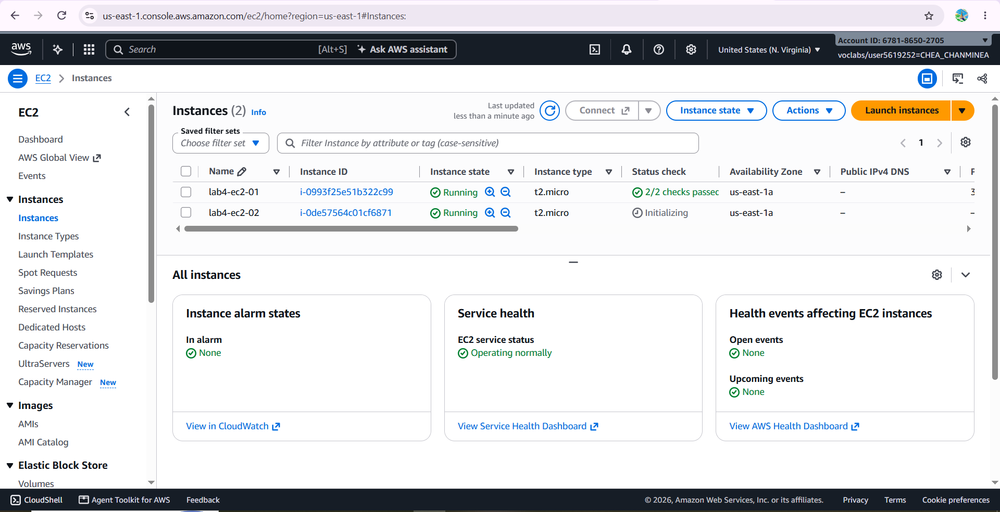

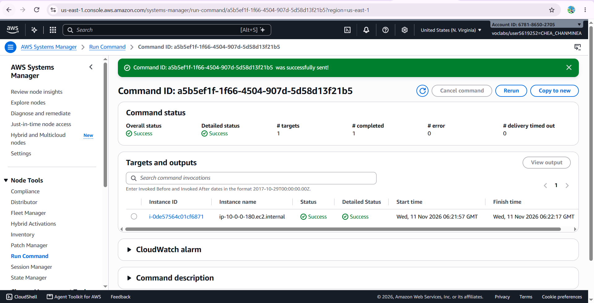

---

## Questions

1. For VPC with `10.0.0.0/24`, there are 256 IP addresses, and the subnets with `10.0.0.0/25` and `10.0.0.128/25` consist of 128 IP addresses each. Since the number of IP addresses are 128 for each, 1st subnet start from `10.0.0.0` to `10.0.0.127`, and 2nd subnet begins with `10.0.0.128` to `10.0.0.255`, that's why they don't overlap.
2. Since both subnets are in the same VPC, something that makes `lab4-public-subnet` public is its route table that contains Internet Getway `0.0.0.0/0`, and is like the door to the internet. On the other hand, something that makes `lab4-private-subnet` private is also its route table that there is no route to the Internet Getway, and it points to NAT Getway instead.
3. The NAT Getway is placed in the **public** subnet and not in the private because NAT Getway needs to reach the internet, and the **public** subnet has a door (Internet Getway) that allows NAT Getway to access the internet.
4. `lab4-ec2-02` has no public IP address. No one on the internet open a connection to it because:
   - It has no public IP, so there’s no address to connect to.
   - Its subnet has no route to the IGW.
   - The NAT gateway only handles connections that the private instance starts. It doesn’t forward new inbound connections from outside. 

   But it can download updates because:
   
   - Its route table sends `0.0.0.0/0` to the NAT gateway.
   - The NAT gateway forwards the request out through the IGW, using its own public IP.
   - Responses come back to the NAT gateway, which passes them to the instance.
   - The security group must also allow outbound traffic (it does by default).
5. The instances needed LabInstanceProfile because the SSM Agent has to authenticate to Systems Manager before AWS will let it register or run commands. The role (LabRole) holds the permissions, and the instance profile is what attaches that role to the EC2 instance. Without it, the instance would not appear as a managed node. Using SSM also avoids opening SSH, since the agent connects outbound, which works even for the private instance.

## Problems and how I solved them (optional)

## AI note (optional)

One suggestion an AI tool gave you and how you checked it.

## Clean up

- [done] Instances terminated.
- [done] NAT gateway deleted and its Elastic IP released.
- [done] Internet gateway detached and deleted.
- [done] `lab4-vpc` deleted.